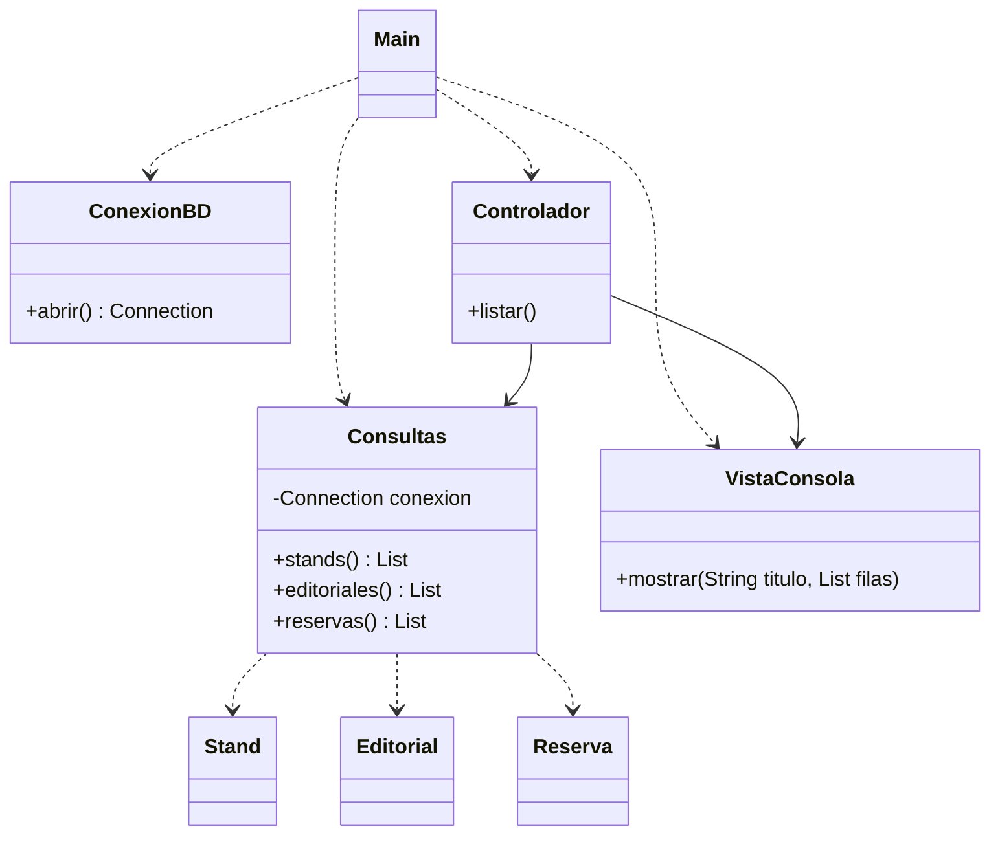
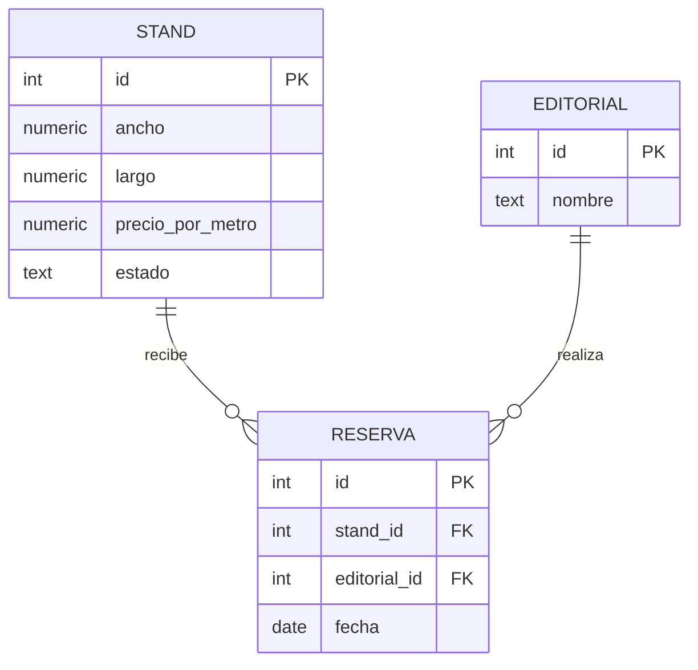

# PD4 · Stands de FILEY

La actividad retoma los stands y editoriales del PD2. Main abre una conexión JDBC con PostgreSQL en Neon. El controlador pide las tres listas a Consultas, que ejecuta un SELECT por tabla y convierte las filas en objetos. VistaConsola imprime los resultados.

## Ejecución

1. En el SQL Editor de Neon, selecciona la base neondb de la rama production y ejecuta [filey.sql](database/filey.sql). Crea las tablas y carga dos stands, dos editoriales y una reservación.
2. Abre PowerShell en la carpeta pd4 con JDK 17 o posterior y Maven instalados. Ejecuta:

```powershell
$cred = Get-Credential -UserName neondb_owner -Message "Contraseña de Neon"
$env:BD_CLAVE = $cred.GetNetworkCredential().Password
mvn compile exec:java
Remove-Item Env:BD_CLAVE
```

## Diagrama de clases



## Diagrama entidad-relación


