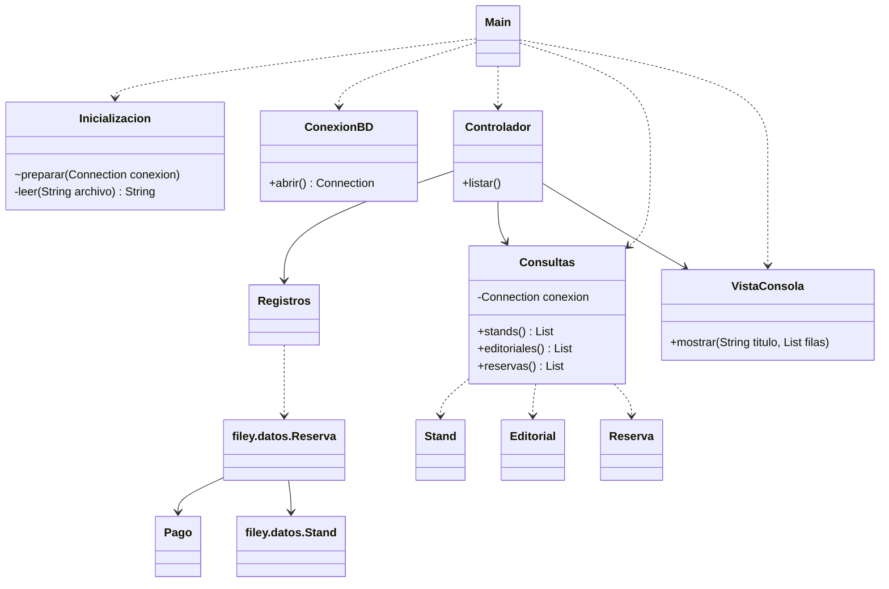
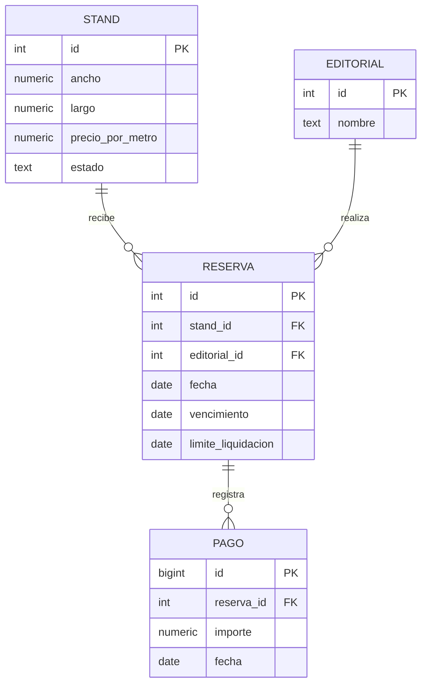

# PD4 · Stands de FILEY

La actividad retoma los stands y editoriales del PD2. Main solicita a ConexionBD una conexión JDBC con PostgreSQL en Neon. El controlador pide las tres listas a Consultas, que ejecuta un SELECT por tabla y convierte las filas en objetos. VistaConsola imprime los resultados.

ConexionBD solo abre la conexión. Consultas contiene los SELECT de los listados y Registros las operaciones para guardar editoriales, stands, reservas y pagos. Inicializacion ejecuta los scripts de creación y recuperación de datos. Estas clases reciben la conexión que Main abre y cierra; Main también controla la transacción, sin ejecutar SQL directamente.

## Ejecución

Desde la carpeta pd4, con JDK 17 o posterior y el controlador JDBC, ejecuta en PowerShell:

```powershell
Invoke-WebRequest https://jdbc.postgresql.org/download/postgresql-42.7.8.jar -OutFile postgresql-42.7.8.jar
New-Item -ItemType Directory -Force out | Out-Null
$archivos = (Get-ChildItem src/main/java -Recurse -Filter *.java).FullName
javac -encoding UTF-8 -d out $archivos
$clave = Read-Host "Contraseña de Neon" -AsSecureString
$env:BD_CLAVE = [System.Net.NetworkCredential]::new('neondb_owner', $clave).Password
$cp = "out;postgresql-42.7.8.jar"
java -cp $cp filey.Main
```

Java crea el esquema y las tablas que falten. Si el esquema ya existe, conserva las filas. Las reservas anteriores siguen disponibles para consulta. Las nuevas incluyen fechas límite para aplicar las reglas de pago de la PD2.

## Ejemplo desde Java

Usa identificadores libres. La reserva recibe, en orden, el ID de reserva, stand, editorial y dos fechas límite. En este ejemplo el total es 1,200. Después de abonar 100 pesos sigue reservado y con otros 80 pasa a ocupado. Cada pago se registra en una ejecución distinta.

```powershell
java -cp $cp filey.Main editorial 40 "Editorial Peninsular"
java -cp $cp filey.Main stand 40 3 4 100
$vence = (Get-Date).AddDays(3).ToString('yyyy-MM-dd')
$limite = (Get-Date).AddDays(10).ToString('yyyy-MM-dd')
java -cp $cp filey.Main reservar 40 40 40 $vence $limite
java -cp $cp filey.Main pagar 40 100
java -cp $cp filey.Main pagar 40 80
```

Registros recupera la reserva y sus pagos, aplica los métodos del paquete filey.datos de PD2 y guarda el pago y el estado del stand en una transacción. La vista lista las filas mediante Consultas.

## Diagrama de clases



## Diagrama entidad-relación


