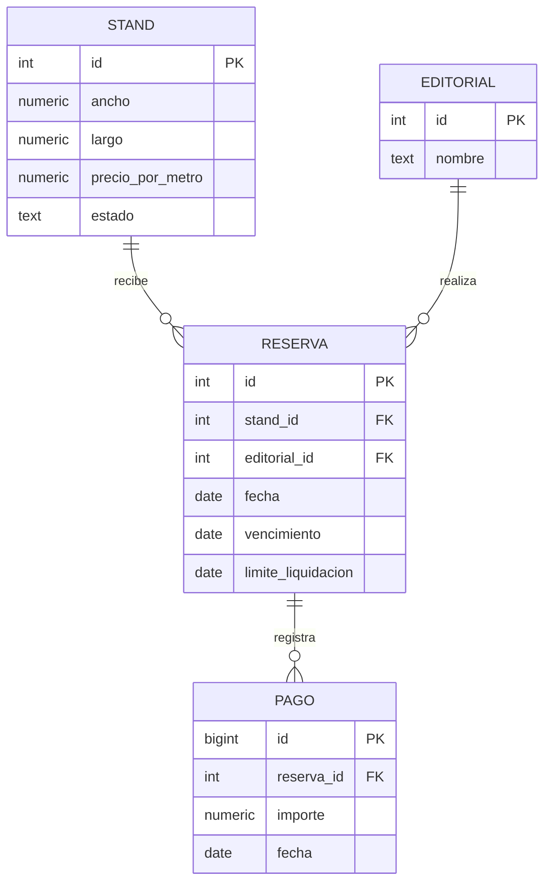

# PD5 · Stands de FILEY

Continuación de PD4 con CRUD de stands, editoriales y reservas mediante JDBC. Conserva los modelos, las reglas de pago, los scripts de inicialización y la conexión a PostgreSQL en Neon. Al alcanzar el 15 % abonado, el stand pasa de reservado a ocupado.

## Organización

El modelo está en `filey.datos`. `Controlador` interpreta los argumentos y solicita las operaciones; `VistaConsola` presenta las listas. `ConexionBD` abre la conexión y no ejecuta consultas. `Inicializacion` prepara las tablas. `Main` coordina la conexión, la transacción y la presentación de resultados.

Las operaciones se dividen por responsabilidad: `Consultas` lee y `Registros` escribe. Cada entidad tiene métodos específicos; se conserva esta organización de PD4 sin añadir una jerarquía de clases.

| Entidad | Crear en Registros | Leer en Consultas | Actualizar en Registros | Eliminar en Registros |
|---|---|---|---|---|
| Editorial | editorial | editoriales | editarEditorial | eliminarEditorial |
| Stand | stand | stands | editarStand | eliminarStand |
| Reserva | reservar | reservas | editarReserva | eliminarReserva |

La edición de editoriales cambia el nombre. La de stands cambia dimensiones y tarifa únicamente si están disponibles y no tienen reservas. La de reservas cambia los plazos, sin alterar sus asociaciones y únicamente si no tienen pagos. Se rechazan fechas anteriores a la creación o un vencimiento posterior al límite de liquidación.

No se eliminan editoriales o stands referenciados por reservas. Eliminar una reserva sin pagos libera su stand dentro de la misma transacción; se rechaza si el stand tiene otras reservas. Los pagos se conservan como en PD4: registran los abonos y permiten reconstruir el porcentaje pagado. No se añade edición ni eliminación de pagos.

## Ejecución

Desde `pd5`, con JDK 17 o posterior, ejecuta en PowerShell:

```powershell
Invoke-WebRequest https://jdbc.postgresql.org/download/postgresql-42.7.8.jar -OutFile postgresql-42.7.8.jar
New-Item -ItemType Directory -Force out | Out-Null
$archivos = (Get-ChildItem src/main/java -Recurse -Filter *.java).FullName
javac -encoding UTF-8 -d out $archivos
$clave = Read-Host "Contraseña de Neon" -AsSecureString
$env:BD_CLAVE = [System.Net.NetworkCredential]::new('neondb_owner', $clave).Password
$cp = "out;postgresql-42.7.8.jar"
java -cp $cp filey.Main
```

Se usa el mismo esquema `pd4` de Neon para continuar con los registros existentes. No hay que borrar tablas ni volver a cargar datos. Las operaciones de esta entrega modifican esa misma base. Sin argumentos, Main muestra la conexión y las tres listas; después de una operación también muestra las listas actualizadas.

## Prueba del CRUD

Ejecuta una línea a la vez y usa IDs libres. Si 50 ya existe, reemplázalo en todo el ejemplo.

```powershell
java -cp $cp filey.Main editorial 50 "Editorial de prueba"
java -cp $cp filey.Main editar-editorial 50 "Editorial actualizada"
java -cp $cp filey.Main stand 50 3 4 100
java -cp $cp filey.Main editar-stand 50 4 4 100
$vence = (Get-Date).AddDays(3).ToString('yyyy-MM-dd')
$limite = (Get-Date).AddDays(10).ToString('yyyy-MM-dd')
java -cp $cp filey.Main reservar 50 50 50 $vence $limite
$nuevoLimite = (Get-Date).AddDays(12).ToString('yyyy-MM-dd')
java -cp $cp filey.Main editar-reserva 50 $vence $nuevoLimite
java -cp $cp filey.Main
java -cp $cp filey.Main eliminar-reserva 50
java -cp $cp filey.Main eliminar-stand 50
java -cp $cp filey.Main eliminar-editorial 50
```

Para probar pagos, antes de eliminar la reserva se puede ejecutar `java -cp $cp filey.Main pagar 50 240`. El total del stand editado es $1,600 y ese abono representa el 15 %. En ese caso, la eliminación posterior debe rechazarse porque existe un pago. Se conserva también el comando `prueba30` de PD4, que crea dos stands y abona el 30 % a uno; rechaza repetir la reserva 30003.

## Excepciones

| Excepción | Dónde se genera | Condición y tratamiento |
|---|---|---|
| SQLException | ConexionBD, Inicializacion, Consultas y Registros | Fallos de conexión o SQL. Main informa el error; distingue ID duplicado (23505), relación inválida (23503) y restricción incumplida (23514). |
| IOException | Inicializacion.leer | No se puede leer un script de database. Main muestra el error. |
| IllegalArgumentException | Controlador, Registros y clases del modelo | Comando o cantidad de argumentos incorrectos, registro inexistente, ID o importe inválido, nombre vacío, fechas incompatibles o pago superior al saldo. |
| NumberFormatException | Controlador.operar | Un ID o importe no es numérico. Es una subclase de IllegalArgumentException. |
| DateTimeParseException | Controlador.operar | Una fecha no tiene formato yyyy-MM-dd o no existe. |
| IllegalStateException | Registros y modelo | Operación incompatible con reservas o pagos existentes, estado inválido del stand o plazo de pago vencido. |
| ArithmeticException | Stand y Pago del modelo | Tarifa o pago con fracciones inferiores a un centavo. |
| NullPointerException | Modelo mediante requireNonNull | Un llamador Java omite un valor obligatorio; los comandos reciben textos, no valores null. |

Las excepciones se propagan hasta Main. Si falla la operación antes del commit, Main intenta rollback para no guardar cambios parciales. Los recursos JDBC se cierran con try-with-resources. El programa informa el error y termina con código 1; no se crean excepciones propias.

## Comprobación

Se compiló el código con Java y se probaron el cambio de estado al alcanzar exactamente el 15 %, el rechazo de sobrepagos y la validación de una editorial inválida. Las pruebas contra Neon deben ejecutarse con las credenciales del usuario; no se presentan las capturas de PD4 como evidencia de este CRUD. Las evidencias anteriores se conservan en [PD4](../pd4/evidencias/README.md).

## Diagrama de clases

```mermaid
classDiagram
Main ..> Inicializacion
Controlador --> Registros
Registros ..> ReservaDominio
ReservaDominio --> Pago
ReservaDominio --> StandDominio
class ReservaDominio["filey.datos.Reserva"]
class StandDominio["filey.datos.Stand"]
Main ..> ConexionBD
Main ..> Controlador
Main ..> Consultas
Main ..> VistaConsola
Controlador --> Consultas
Controlador --> VistaConsola
Consultas ..> Stand
Consultas ..> Editorial
Consultas ..> Reserva
class Inicializacion {
  ~preparar(Connection conexion)
  -leer(String archivo) String
}
class ConexionBD {
  ~abrir() Connection
}
class Consultas {
  -Connection conexion
  ~stands() List
  ~editoriales() List
  ~reservas() List
}
class Registros {
  -Connection db
  ~editorial(id, nombre)
  ~stand(id, ancho, largo, tarifa)
  ~reservar(id, standId, editorialId, vence, limite)
  ~pagar(reservaId, importe)
  ~editarEditorial(id, nombre)
  ~editarStand(id, ancho, largo, tarifa)
  ~editarReserva(id, vence, limite)
  ~eliminarEditorial(id)
  ~eliminarStand(id)
  ~eliminarReserva(id)
}
class Controlador {
  ~operar(String[] args)
  ~listar()
}
class VistaConsola {
  ~mostrar(String titulo, List filas)
}
```



## Diagrama entidad-relación


